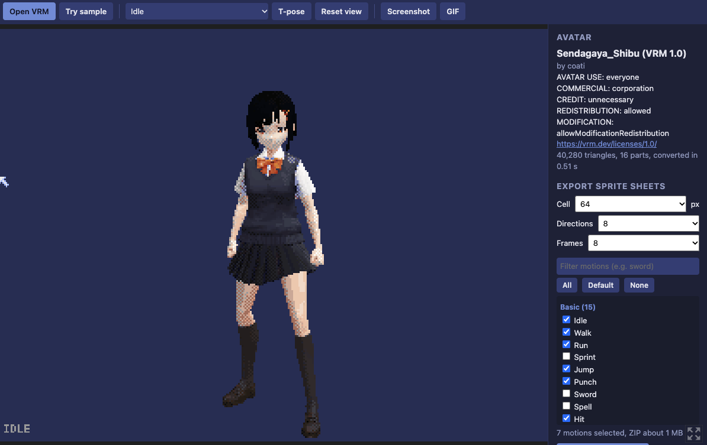
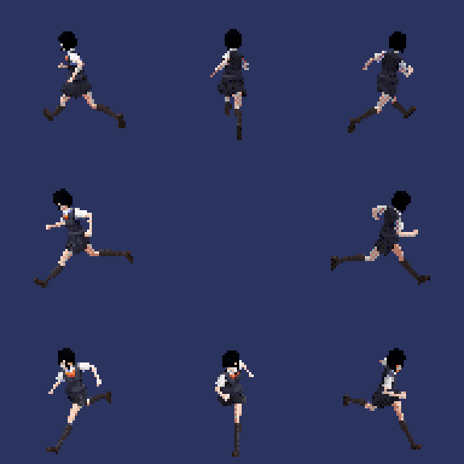
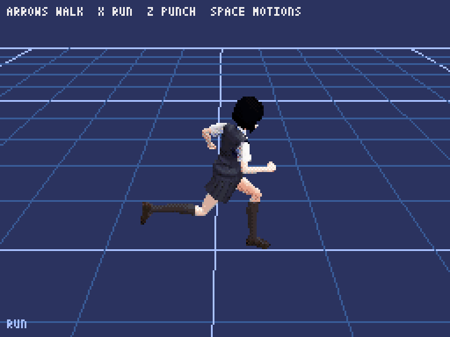
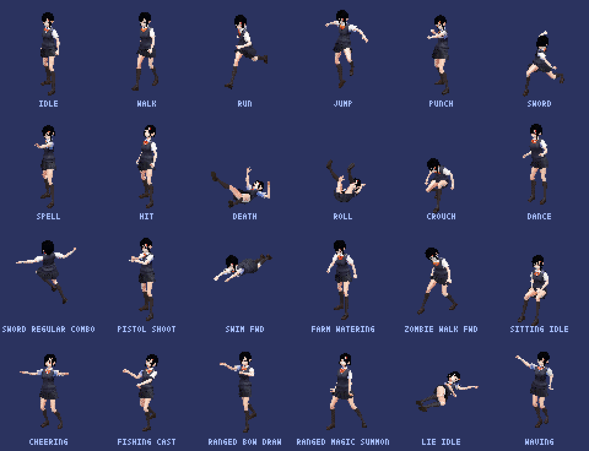

# VRM RETRO VIEWER

[日本語](README.ja.md)

Open a VRM avatar (0.x or 1.0) and see it as a retro 3D figure in [Pyxel 3](https://github.com/kitao/pyxel). Play it with 231 CC0 motions, then export **2D sprite sheets** (PNG / GIF) or **3D data for Pyxel 3** as a zip.

- **Try it in your browser (free):** [haruka-apps-games.itch.io/vrm-retro-viewer](https://haruka-apps-games.itch.io/vrm-retro-viewer)
- **How it was made (Japanese):** [Qiita article](https://qiita.com/haruka_apps/items/29b897418b601cfacb6c)



| Sprite sheet export (8 directions) | 3D export, running in Pyxel 3 |
|---|---|
|  |  |

Your file is never uploaded. Reading and converting happen inside your browser (or your own computer).

## Features

- Reads VRM 0.x and 1.0. Shows the avatar's license (meta) and warns in red when it forbids modification or redistribution
- 231 motions, all CC0 (Quaternius Universal Animation Library 1 & 2, KayKit Character Animations), with search and groups
- **Sprite export:** 32–128 px, 8 or 4 directions, Retro (6 fps) / Standard (10 fps) / Smooth (15 fps) or a fixed frame count, any set of motions. Transparent background, one shared 256-colour palette, `sheet.json`, and a small Pyxel sample
- **Live preview:** the screen shows the sprites exactly as they will be exported (size, speed, angle, all directions)
- **Your own motions:** add `.fbx` (Mixamo, Unreal-style such as Quaternius, VRoid skeletons) and `.vrma` files, and export them like the bundled ones
- **3D export for Pyxel 3:** the converted avatar and all motions, plus `vrm_figure.py` to load and play them. Works on Code & Magic as well
- Screenshot (PNG) and GIF of the screen
- A sample avatar (Sendagaya Shibu, CC0) is included, so you can try it without your own VRM



## Run it yourself

You need Python 3 and Pyxel 3 (`pip install pyxel numpy pillow`).

**Desktop**

```bash
python main.py                 # then drop a .vrm file on the window
python main.py avatar.vrm      # or open a file directly
```

**Browser** (the same build as itch.io)

```bash
cd web
python -m http.server
```

Then open `http://localhost:8000`. The first start takes a while (Pyodide, NumPy and Pillow are loaded).

To rebuild `web/vrm_viewer.pyxapp` and the itch.io zip: `python tools/build_web.py`.

## Controls

| Input | Action |
|---|---|
| Drag / wheel | Turn / zoom |
| ← → / ↑ ↓ | Turn / zoom |
| SPACE | Next motion |
| T | T-pose |
| E | Export sprites with the default set (idle / walk / run / jump / punch / hit / death; 64 px, 8 directions, 10 fps) |
| V | Sprite preview on / off (desktop; 64 px, 8 directions, 10 fps) |
| D | Export 3D for Pyxel |
| P / G | Screenshot / GIF |
| L | License overlay on / off (desktop) |
| F1 | Timings |

In the browser, the tool bar and the panel do the same and more.

## Sprite export (`<name>_sprites.zip`)

Settings in the panel:

- **Size:** 32–128 px per cell. **Directions:** 8 or 4
- **Animation:** Retro (6 fps), Standard (10 fps, the default) or Smooth (15 fps). These divide Pyxel's 30 fps evenly. Frames are 1/fps seconds apart, so a longer motion gets more frames
- **Advanced:** the same frame count (4 / 6 / 8 / 12) for every motion instead
- One sheet is at most 8192 px wide (128 frames at 64 px). A longer motion is spread over that, so it is a little less smooth; the panel names it
- **Preview:** changing a setting switches the screen to the sprites as they will be exported. "Back to 3D" returns

| File | Contents |
|---|---|
| `<name>_<motion>.png` | One sheet per motion. Rows = directions, columns = frames |
| `<name>_<motion>.gif` | The front row of the sheet as an animation: the same frames at the same speed (2× size) |
| `<name>_all.png` | All motions stacked (only when it is 8192 px tall or less) |
| `sheet.json` | Cell size, direction order, how frames were chosen (`timing`), per motion: file, frames, fps, loop, y in `_all.png`, and `palette` (the 256 colours of every PNG) |
| `README.txt` | The format, and the license of the source VRM |
| `pyxel_sample/` | `sample_sprites.py` and `HOW_TO_RUN.txt` (English and Japanese) |

- Direction order (8): down, down-left, left, up-left, up, up-right, right, down-right. (4): down, left, up, right
- Transparent pixels are stored as magenta (0xFF00FF) with alpha 0, so Pyxel can use magenta as the colour key and other tools see normal transparency
- In Pyxel, set `pyxel.colors` to `palette` from `sheet.json` first, then load the PNGs with `Image.from_image`. The colours then match exactly

## 3D export for Pyxel 3 (`<name>_pyxel3d.zip`)

| File | Contents |
|---|---|
| `model.tmx` | Mesh, bones, weights, palette and the source VRM's info (NumPy `.npz`, base64 inside a 1×1 Tiled map) |
| `tex_*.png` | Textures, drawn only with the palette colours |
| `motions.tmx` | The 231 motions (same format, about 2.8 MB) |
| `my_motions.tmx` | Only when you added motions (FBX / VRMA). `vrm_figure.py` reads it too; their ids start with `my_` |
| `vrm_figure.py` | Loads and plays them. Uses only pyxel, numpy, json, base64 and io |
| `sample_3d.py` | Walk around on a floor (`pyxel run sample_3d.py`) |
| `README.txt` / `HOW_TO_RUN.txt` | How to use it, the source VRM's license, the disclaimer |

```python
from vrm_figure import Figure

fig = Figure("folder/")      # a pyxel.cube Node
stage.add_child(fig)
fig.play("walk")
fig.animate(1 / 30)          # every frame
```

- Why `.tmx`: Code & Magic accepts only `.py / .png / .tmx / .glb / .ogg / .pyxres`, and a `.tmx` has to be a real Tiled map. The data sits in the map's `data` property
- On Code & Magic, upload every file and rename `sample_3d.py` to `main.py`. If `my_motions.tmx` is over 3 MB (the Code & Magic limit per file), the README and the page say so
- Palette entries 16–255 are used (255 = magenta colour key). Entries 0–15 stay as your game's colours
- Pyxel 3 does not skin GLB meshes, so `vrm_figure.py` skins on the CPU with NumPy

[`examples/shibu_pyxel3d/`](examples/shibu_pyxel3d/) is this export for the sample avatar, ready to run (the same files the author ran on Code & Magic).

## Your own motions (FBX / VRMA)

**Add motion** (or drop the file) adds motions to "Your motions" at the top of the list. They can be previewed and exported like the bundled ones. The file stays on your device.

| Format | What is read |
|---|---|
| `.vrma` (VRM Animation) | One motion per file, baked the same way as the bundled motions |
| `.fbx` | Binary FBX 7.x with a humanoid skeleton named like Mixamo (`mixamorig:LeftArm`), Unreal (`upperarm_l`; Quaternius too) or VRoid (`J_Bip_L_UpperArm`). Every animation in the file is added (T-pose-only takes are skipped). Y-up and Z-up both work |

Stopped with a reason: ASCII FBX, FBX 6 or older, bone names it does not know or a non-humanoid skeleton, a file without animation.
Read with a warning: a skeleton that rests in an A-pose (the arms may look wrong; there is no A-to-T correction). Smaller mismatches (a different number of spine bones, curled fingers in the rest pose) are not detected.

- Ids start with `my_`. In an FBX with several animations, names with Loop / Idle / Pose repeat and the rest play once (if no name has "Loop", all repeat)
- Added motions keep the terms of where you got them. Mixamo, for example: fine inside your own games, but do not share the files or the data on their own (see the [Mixamo FAQ](https://community.adobe.com/t5/mixamo-discussions/mixamo-faq-licensing-royalties-ownership-eula-and-tos/td-p/13234775)). The exported README says so too
- From Mixamo: FBX Binary, "Without Skin" is fine, 30 fps
- A KayKit `.vrma` you load does not get the 28° arm fix the bundled KayKit motions have
- File names that are not plain letters and digits (e.g. Japanese) become "motion"

## Repository layout

| Path | What it is |
|---|---|
| `main.py` | The viewer (Pyxel 3). CPU skinning, sprite and 3D export, preview |
| `fbx_io.py` | Reads the skeleton and animations of a binary FBX 7.x; bone-name tables, axis detection |
| `vrma_io.py` | Reads a VRM Animation (`.vrma`) |
| `vrm_io.py` | Reads VRM 0.x / 1.0 (GLB) into NumPy data, builds the palette |
| `vrm_figure.py`, `sample_3d.py`, `sample_sprites.py` | Files that go into the exported zips |
| `motions.npz` | The 231 motions, baked by `tools/make_motions.py` |
| `web/` | `index.html` (tool bar and panel), `vrm_viewer.pyxapp`, `sample.vrm` |
| `tools/` | `build_web.py`, `make_motions.py`, `make_sample_vrm.py` |
| `examples/shibu_pyxel3d/` | A 3D export of the sample avatar |
| `docs/images/` | Screenshots |

The source motions for `tools/make_motions.py` are not in this repository. They come from [open-vrma](https://huggingface.co/datasets/Sanami/open-vrma) (only the CC0 clips: Quaternius and KayKit). See the top of `tools/make_motions.py`.

## Tested

- **Cloud Linux, Pyxel 3.0.1 (desktop):** VRM 1.0 (Sendagaya Shibu) and VRM 0.x; motions; sprite and 3D export; the exported 3D runs with `sample_3d.py` alone
- **FBX / VRMA (cloud):** two Mixamo files and Quaternius `UAL1_Standard.fbx` (42 animations), checked against the FBX skeleton itself and the original GLB (mean difference 0–1.7°); a `.vrma` of a bundled motion gives the bundled data bit for bit (as float16); the error messages; A-pose detection (a rest pose with the arms turned 40° down)
- **Browser (the author, on a Mac, Pyxel 3.0.1):** tool bar, panel, sample, search, export and download; adding Mixamo FBX and a VRMA; the preview
- **Code & Magic (the author):** the exported 3D data runs, also with `my_motions.tmx`

Not tested: phones, Windows (the `HOW_TO_RUN.txt` steps), browsers other than the author's, a real A-pose FBX (e.g. the Unreal mannequin), FBX from VRoid or Blender Rigify, reading a big FBX (23 MB) in the browser.

## License

The code is under the [MIT License](LICENSE) (© 2026 haruka_apps).

Assets in this repository have their own licenses:

- Motions in `motions.npz` and in the 3D export (`motions.tmx`): Quaternius "Universal Animation Library" 1 & 2 and Kay Lousberg "KayKit Character Animations" (CC0 1.0), converted to .vrma by the open-vrma project
- `web/sample.vrm` and `examples/shibu_pyxel3d/`: Sendagaya Shibu, a CC0 sample model of VRoid (VRM data by coati). Made smaller for this tool with `tools/make_sample_vrm.py` (smaller textures, no facial blend shapes)

Avatars you load keep their own licenses. Following them is up to you. The tool shows each avatar's terms and writes them into every export.

## Disclaimer

This tool and the files it exports are provided "AS IS", without warranty of any kind. The author (haruka_apps) is not responsible for any damage or trouble caused by using them.

## Credits

- [Pyxel](https://github.com/kitao/pyxel) 3 by Takashi Kitao (MIT License)
- In the browser: Pyodide (MPL-2.0), NumPy (BSD-3-Clause), Pillow (MIT-CMU)
- Motions: [Quaternius](https://quaternius.com/) (CC0), Kay Lousberg / KayKit (CC0), via [open-vrma](https://huggingface.co/datasets/Sanami/open-vrma)
- Sample avatar: Sendagaya Shibu (VRoid, CC0)
